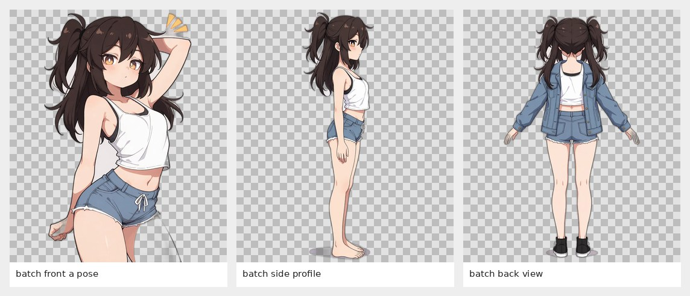
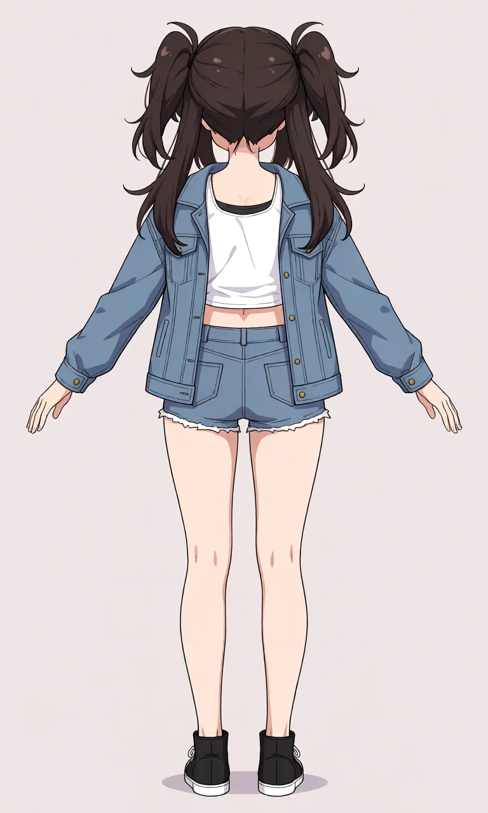

# Pibara — galería de anatomía (borradores)

**Ejecución:** [GitHub Actions #39500149462](https://github.com/rikosama473-sketch/image/actions/runs/39500149462)  
**Estado:** parcial, 3 de 4 vistas guardadas. El servicio público agotó su cuota antes del estudio de articulaciones.  
**Tamaño de lienzo:** 768×1280 en los tres renders y sus PNG transparentes.  
**Revisión:** ninguno de estos archivos está aprobado como modelo de identidad definitivo.

## Vista conjunta

## 1. Frontal — incompleta

[PNG transparente de la frontal](transparent/01-batch-front-a-pose.png)

**No usar como pose A final:** el modelo recortó las piernas y levantó un brazo. Tampoco conserva fielmente los colores de pelo/ojos ni el vestuario de Pibara.

## 2. Perfil lateral — cuerpo entero

[PNG transparente del perfil lateral](transparent/02-batch-side-profile.png)

Es legible como referencia lateral de proporciones, pero cambió el pelo, los ojos y la ropa. Mantener como borrador provisional.

## 3. Vista trasera — cuerpo entero

[PNG transparente de la vista trasera](transparent/03-batch-back-view.png)

Es legible como referencia posterior y muestra la silueta del pelo y la ropa desde atrás, pero el diseño no es una coincidencia fiel con el personaje original.

## Datos y procedencia

- [Manifiesto con hashes, estado parcial y notas de revisión](manifest.json)
- [Prompts de las cuatro vistas solicitadas](PROMPTS.md)
- Referencia original: \`from-PixAI-2034984086876227343-0.png\`
- La generación no modifica la referencia original. Las piezas transparentes se crearon mediante eliminación automática del fondo; revisa los bordes antes de reutilizarlas.

La cuarta vista (\`batch-joint-guide\`) no se creó porque el proveedor informó: **“You have exceeded your ZeroGPU runs limit.”** El resto de los archivos producidos se guardó en esta carpeta y ya aparece en la biblioteca local del editor.
